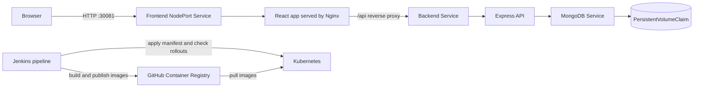

# Kubernetes E-Commerce Platform

A React and Express product catalog packaged as Docker images and deployed to Kubernetes. The repository demonstrates container builds, CI checks, image publishing, Kubernetes Services and Deployments, health probes, resource limits, and persistent database storage.

<p align="center">
  
  
</p>

## Technology

- **Application:** React, Vite, Node.js, Express, MongoDB
- **Platform:** Docker, Kubernetes, Jenkins, GitHub Actions, GitHub Container Registry
- **Serving:** Nginx frontend with an `/api` reverse proxy

## Architecture



The Kubernetes manifest exposes the frontend through NodePort `30081`. Nginx serves the React single-page application and proxies `/api` requests to the internal backend Service. The Express API currently exposes product CRUD routes and a health endpoint. MongoDB data is mounted from a PersistentVolumeClaim. Deployments specify resource requests and limits; the frontend and backend use HTTP probes and MongoDB uses TCP probes.

## Application

The current UI is a product catalog and management screen. It supports listing, filtering, creating, editing, and deleting products through the Express API. Authentication, cart, and order modules exist in the source tree but are not currently connected to the running app/API, so they are not presented as working features here.

## Build and deployment

The Jenkins pipeline runs application checks, builds and scans container images, publishes versioned images to GHCR, then creates the required Kubernetes Secrets, applies `k8s/app.yaml`, and waits for MongoDB, backend, and frontend rollouts.

GitHub Actions also contains CI and release workflows. CI checks backend syntax, builds the frontend, and verifies Docker builds. The release workflow publishes images to GHCR; its optional remote deployment uses Docker Compose over SSH, not Kubernetes.

## Run locally

Requirements: Node.js 20+, Docker with the Compose plugin.

```bash
docker compose up --build
```

The local Compose stack starts MongoDB, the backend, and the frontend. Open `http://localhost:5173`. For development, install dependencies in `backend/` and `frontend/`, then start each with `npm run dev`. See [`backend/.env.example`](backend/.env.example) and [`frontend/.env.example`](frontend/.env.example) for environment variable examples.

## Kubernetes

The manifest defines a namespace, frontend and backend Services and Deployments, a MongoDB Deployment and Service, and a MongoDB PVC. The image fields `${BACKEND_IMAGE}` and `${FRONTEND_IMAGE}` must be substituted before applying; Jenkins handles that during deployment. The Jenkins deployment also provisions the `ecommerce-secrets` and `ghcr-pull-secret` Kubernetes Secrets from Jenkins credentials.

For manual deployment requirements and verification commands, see [`docs/KUBERNETES_DEPLOYMENT.md`](docs/KUBERNETES_DEPLOYMENT.md). Once deployed, the frontend is reachable at `http://<node-address>:30081` when permitted by cluster networking and the node firewall. The API health endpoint is `/api/health`.

## Repository layout

```text
backend/                 Express API and MongoDB models
frontend/                React product catalog and Nginx configuration
k8s/app.yaml             Kubernetes application resources
Jenkinsfile              CI, image publishing, and Kubernetes deployment
docs/images/             Application screenshots
.github/workflows/       GitHub Actions CI, release, and security workflows
```

## Security

Keep credentials in Jenkins, GitHub Actions secrets, or Kubernetes Secrets. Do not commit populated `.env` files, access tokens, certificates, or Secret manifests. Example environment files are templates only.
