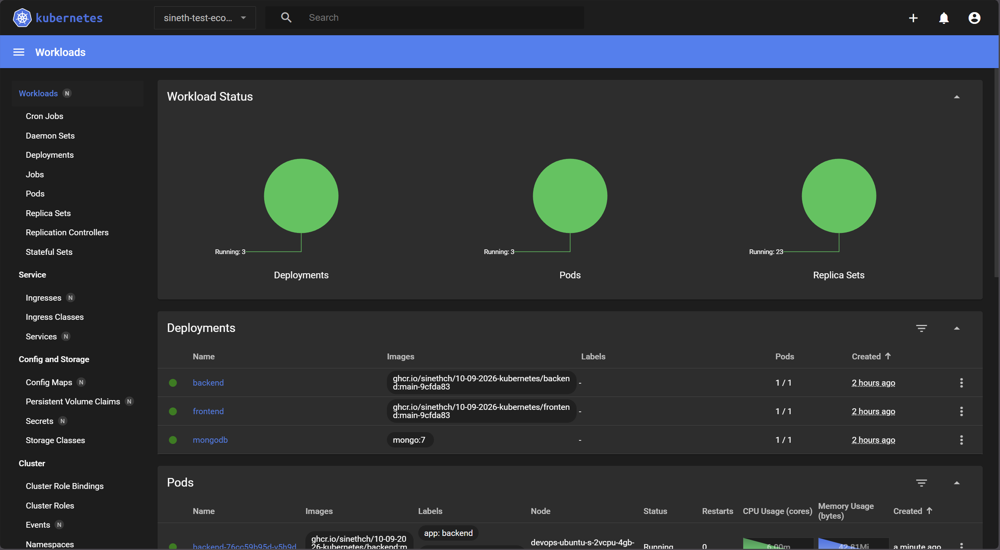
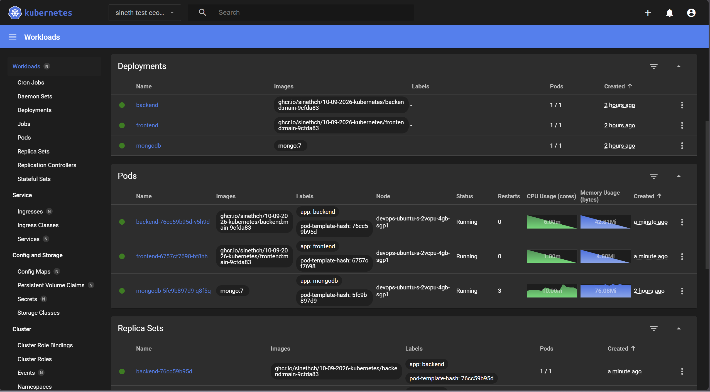
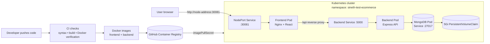

# Kubernetes implementation 

> **A hands-on DevOps project that turns a React + Express application into a repeatable, observable, and containerized Kubernetes deployment.**

<p align="center">
  
  
</p>

<p align="center">
  <strong>Build it • Package it • Ship it • Run it reliably</strong>
</p>

<p align="center">
  
  
  
  
  
</p>

## Why I built this

I built this project to practice the complete path from source code to a running workload:

1. Validate backend and frontend changes automatically.
2. Package each application layer as a reproducible Docker image.
3. Publish versioned images to a container registry.
4. Deploy the images as Kubernetes workloads.
5. Add health checks, resource boundaries, secrets, and persistent storage.
6. Verify that the application is ready before sending traffic to it.

This is not only an e-commerce UI. It is a small platform engineering exercise focused on **repeatability, failure detection, secure configuration, and operational clarity**.

## The Kubernetes deployment path

The diagram below shows the current application path only. It intentionally does not mix in alternate automation or local Compose workflows.



### Request flow

- The browser reaches the **frontend NodePort Service** on `30081`.
- Nginx serves the compiled React single-page application.
- Requests beginning with `/api/` stay on the same origin and are reverse-proxied to the internal `backend` Service.
- Express exposes the health endpoint at `/api/health` and product CRUD routes at `/api/products`.
- The backend connects to MongoDB through the internal `mongodb` Service.
- MongoDB stores its data on the `mongodb-data` PersistentVolumeClaim, so a Pod replacement does not automatically remove application data.

## What is implemented

### Application

- React + Vite storefront and product-management interface.
- Express API with product create, read, update, and delete operations.
- MongoDB persistence through Mongoose.
- Nginx production serving for static frontend assets.
- Same-origin `/api` reverse proxy to keep frontend and API traffic simple in the cluster.

### DevOps and platform engineering

- Separate Docker images for the frontend and backend.
- Multi-stage frontend image: Node.js build stage, lightweight Nginx runtime stage.
- Kubernetes Namespace, Deployments, Services, and PersistentVolumeClaim.
- Private registry image pulls through `ghcr-pull-secret`.
- Database configuration injected through the `ecommerce-secrets` Secret.
- Readiness and liveness probes for frontend, backend, and MongoDB.
- CPU and memory requests/limits for predictable scheduling and protection from runaway usage.
- Automated CI checks for backend syntax, frontend builds, and Docker image builds.
- Dependency and container vulnerability scanning with npm audit and Trivy.
- Dependabot configuration for dependency, Docker base-image, and GitHub Actions updates.
- Husky pre-commit checks for fast feedback before code reaches the repository.

> **Scope note:** The source tree contains auth, cart, and order modules, but the currently wired and demonstrated running feature is the product catalog and management flow. This README describes only verified application behavior.

## CI and release mindset

```text
Pull request / feature change
          |
          v
Backend syntax + frontend build + Docker build verification
          |
          v
Security checks: npm audit + Trivy image scan
          |
          v
Versioned frontend/backend images published to GHCR
          |
          v
Kubernetes manifest receives image references
          |
          v
Rollout status + health probes confirm readiness
```

The Kubernetes manifest uses `${BACKEND_IMAGE}` and `${FRONTEND_IMAGE}` placeholders. This keeps the deployment definition reusable across environments while allowing an automation system or operator to select an immutable image tag for each release.

## Kubernetes quick start

### Prerequisites

- A Kubernetes cluster with `kubectl` access.
- A default StorageClass, or a storage class selected in `k8s/app.yaml`.
- Docker images published to a registry reachable by the cluster.
- Permission to create the namespace and Kubernetes Secrets.

### 1. Create runtime secrets

Do not commit real credentials.

```bash
kubectl create namespace sineth-test-ecommerce

kubectl -n sineth-test-ecommerce create secret generic ecommerce-secrets \
  --from-literal=MONGO_URI='mongodb://mongodb:27017/ecommerce'

kubectl -n sineth-test-ecommerce create secret docker-registry ghcr-pull-secret \
  --docker-server=ghcr.io \
  --docker-username=YOUR_GITHUB_USER \
  --docker-password=YOUR_GITHUB_TOKEN
```

### 2. Render image references and apply the manifest

```bash
export BACKEND_IMAGE=ghcr.io/OWNER/REPOSITORY/backend:VERSION
export FRONTEND_IMAGE=ghcr.io/OWNER/REPOSITORY/frontend:VERSION

envsubst < k8s/app.yaml | kubectl apply -f -
```

### 3. Verify the rollout

```bash
kubectl -n sineth-test-ecommerce get pods,services,pvc
kubectl -n sineth-test-ecommerce rollout status deployment/mongodb --timeout=180s
kubectl -n sineth-test-ecommerce rollout status deployment/backend --timeout=180s
kubectl -n sineth-test-ecommerce rollout status deployment/frontend --timeout=180s
```

Open `http://<node-address>:30081` when the node network and firewall allow the NodePort. The API health check is available at `/api/health`.

For detailed manual deployment and troubleshooting commands, see [`docs/KUBERNETES_DEPLOYMENT.md`](docs/KUBERNETES_DEPLOYMENT.md).

## Run locally with Docker Compose

Requirements: Node.js 20+ and Docker with the Compose plugin.

```bash
docker compose up --build
```

Open `http://localhost:5173`. The local stack runs MongoDB, the Express backend, and the Nginx frontend. For development, install dependencies in `backend/` and `frontend/`, then run their development scripts.

## What I learned

- **Container design:** how build-time concerns differ from runtime concerns, and why a small Nginx runtime image is preferable for static assets.
- **Kubernetes networking:** how a public NodePort, an internal Service, and an in-container reverse proxy work together.
- **Release portability:** how image placeholders and environment-specific Secrets keep manifests reusable.
- **Application resilience:** how readiness probes prevent traffic from reaching an unready Pod, while liveness probes trigger recovery when a process becomes unhealthy.
- **Stateful workloads:** why MongoDB needs a PersistentVolumeClaim and a deliberate update strategy.
- **Resource governance:** how requests and limits help Kubernetes schedule workloads and contain resource pressure.
- **Secure delivery:** why credentials belong in registry/CI secret stores and Kubernetes Secrets rather than source control.
- **Shift-left verification:** how syntax checks, builds, image verification, dependency audits, and Trivy scanning reduce deployment risk before runtime.
- **Operational verification:** how rollout status, health endpoints, Pod events, and PVC state turn deployment from “applied” into “confirmed working.”

## Repository map

```text
backend/                    Express API, Mongoose models, and health endpoint
frontend/                   React application, Vite build, and Nginx config
k8s/app.yaml                Kubernetes resources for the complete application
.github/workflows/          CI, release, and security automation
docs/images/                Application screenshots used in this README
docs/KUBERNETES_DEPLOYMENT.md
                            Manual Kubernetes deployment and verification guide
```

## Security notes

- Keep populated `.env` files, tokens, certificates, and Secret manifests out of Git.
- Use short-lived or least-privilege registry credentials where possible.
- Pin production image tags to a release identifier rather than relying on `latest`.
- Review vulnerability scan results before promoting images.
- Use a managed MongoDB service or a production-grade database operator for high-availability production workloads; the included single-replica MongoDB deployment is intended for demonstration and learning.

## Connect with me

If you are interested in DevOps, platform engineering, containerization, or Kubernetes, I would be happy to discuss the design decisions and trade-offs behind this project.
